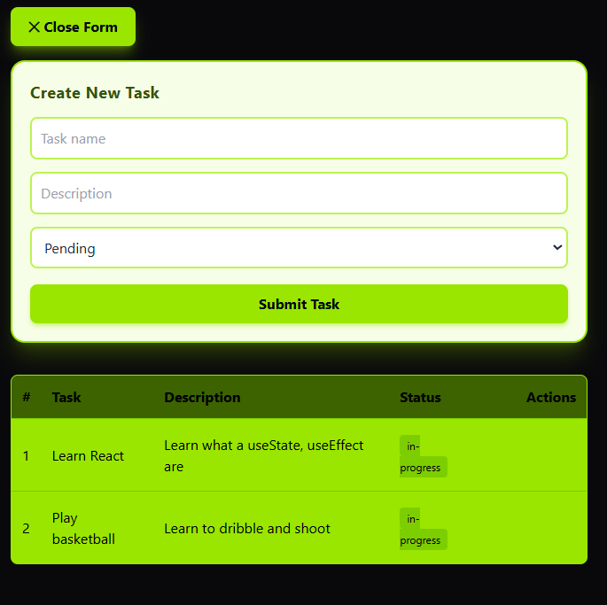

# 📝 PERN Stack Task Manager

A full-stack Todo & Task Management web application built with the **PERN stack** (PostgreSQL, Express.js, React, Node.js), powered by **Vite** and styled with **Tailwind CSS**.

---

## ✨ Features

- **Full CRUD Operations**:
  - **Create**: Add new tasks with title, description, and status (`pending`, `in-progress`, `done`).
  - **Read**: View all tasks organized in a structured, responsive table.
  - **Update**: Seamless **inline row editing**—modify task names, descriptions, and statuses directly within table cells without annoying modal popups.
  - **Delete**: Quickly remove tasks with one-click delete actions.
- **Modern & Interactive UI**:
  - **Neon Accent Design**: Collapsible task creation form with a vibrant neon-lime theme, glow effects, and smooth transitions.
  - **Hover-Activated Actions**: Edit and Delete action buttons appear smoothly upon hovering over table rows (`group-hover`).
  - **Reactive State Management**: Client state syncs immediately with database changes—no full page reloads required.
- **Robust REST API Backend**:
  - Clean Express.js routing architecture.
  - Secure parameterized queries (`$1, $2, ...`) using `pg` to safeguard against SQL injection.
  - Connection pooling via PostgreSQL `Pool` for optimized database operations.
  - Cross-Origin Resource Sharing (`cors`) enabled for smooth client-server communication.
    

---

## 🛠️ Tech Stack

### Frontend

- **Framework**: [React 18+](https://react.dev/)
- **Build Tool**: [Vite](https://vite.dev/)
- **Styling**: [Tailwind CSS](https://tailwindcss.com/)

### Backend

- **Runtime**: [Node.js](https://nodejs.org/)
- **Framework**: [Express.js](https://expressjs.com/)
- **Database Driver**: [`pg` (node-postgres)](https://node-postgres.com/)
- **Development Tooling**: [Nodemon](https://nodemon.io/)

### Database

- **Database**: [PostgreSQL](https://www.postgresql.org/)

---

## 📁 Project Directory Structure

```text
to_do_list_APP/
├── backend/
│   ├── db.js             # PostgreSQL Pool connection configuration
│   ├── database.sql       # Database schema and table definitions
│   ├── server.js          # Express app, middleware, and REST API endpoints
│   └── package.json       # Backend dependencies and scripts
│
├── frontend/
│   ├── src/
│   │   ├── components/
│   │   │   ├── InputTodo.jsx   # Collapsible neon-styled task creation form
│   │   │   └── Tasklist.jsx    # Table view with inline editing and delete actions
│   │   ├── App.jsx             # Top-level state management and API integration
│   │   ├── main.jsx            # React root mount
│   │   └── index.css           # Tailwind CSS imports
│   ├── package.json            # Frontend dependencies and scripts
│   └── vite.config.js          # Vite and Tailwind build plugins
│
└── README.md                   # Project documentation
```

---

## 🔌 API Endpoints

All endpoints run on `http://localhost:1234` by default:

| Method     | Endpoint            | Description               | Request Body                                                  |
| :--------- | :------------------ | :------------------------ | :------------------------------------------------------------ |
| **GET**    | `/todos`            | Get all tasks             | _None_                                                        |
| **GET**    | `/todos/:id`        | Get a specific task by ID | _None_                                                        |
| **POST**   | `/todos`            | Create a new task         | `{ "task": string, "description": string, "status": string }` |
| **PUT**    | `/todos/update/:id` | Update an existing task   | `{ "task": string, "description": string, "status": string }` |
| **DELETE** | `/todos/:id`        | Delete a task             | _None_                                                        |

---

## 🚀 Getting Started

### 1. Database Setup

1. Ensure **PostgreSQL** is running on your machine (default port: `5432`).
2. Open your PostgreSQL terminal (`psql`) or a GUI tool like **pgAdmin** and run:

```sql
CREATE DATABASE todoapp;

\c todoapp;

CREATE TABLE todo (
    todo_id SERIAL PRIMARY KEY,
    task VARCHAR(255) NOT NULL,
    description VARCHAR(255),
    status VARCHAR(255) DEFAULT 'pending'
);
```

3. Configure your database credentials in `backend/db.js`:

```javascript
const pool = new Pool({
  user: "postgres",
  password: "your_password",
  host: "localhost",
  port: 5432,
  database: "todoapp",
});
```

---

### 2. Backend Setup

From the project root:

```bash
cd backend
npm install
npm run dev
```

The server will start listening at `http://localhost:1234`.

---

### 3. Frontend Setup

In a new terminal window, from the project root:

```bash
cd frontend
npm install
npm run dev
```

Open your browser at the local Vite URL (typically `http://localhost:5173`).

---

## 🚢 Deployment Overview

- **Frontend**: Deploy directly to [Vercel](https://vercel.com/) with zero config.
- **Backend**: Deploy the `backend/` directory to [Render](https://render.com/) or [Railway](https://railway.app/).
- **Database**: Host PostgreSQL on [Neon](https://neon.tech/) or [Supabase](https://supabase.com/) (free tier available).
